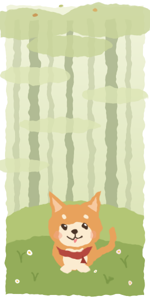

  
<pre>
    🎓 XAUAT • Major in Electronic Information
    💻 Electronic Information Engineering • Code
    🌱 Slow growth • Steady commits • Gentle debugging
    🐕 Dogs are the best • Woof-driven development
    📧 foreverfine2002@163.com
</pre>
 

  
&nbsp;&nbsp;

